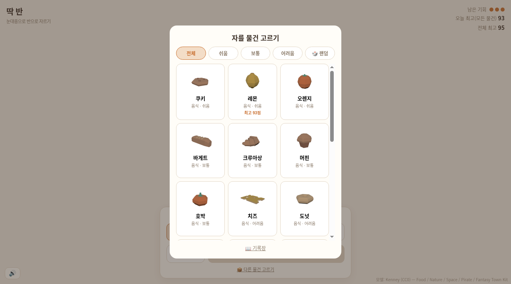
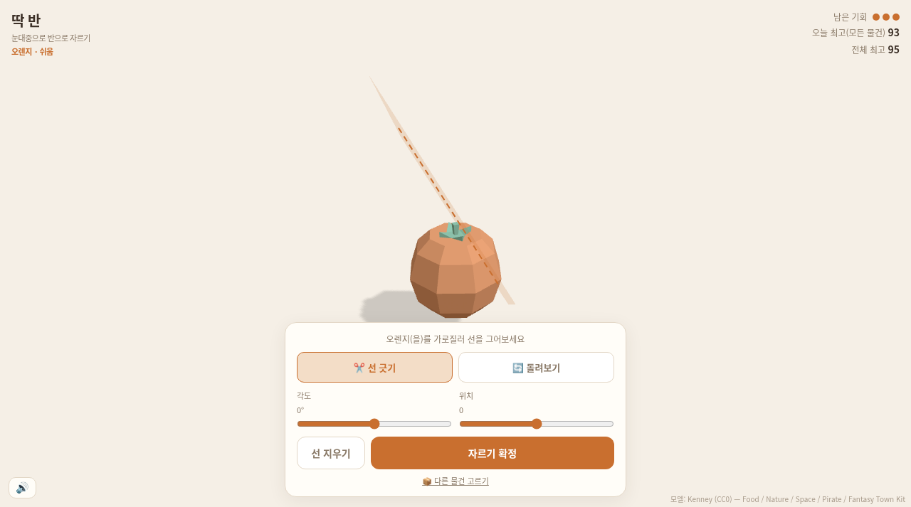
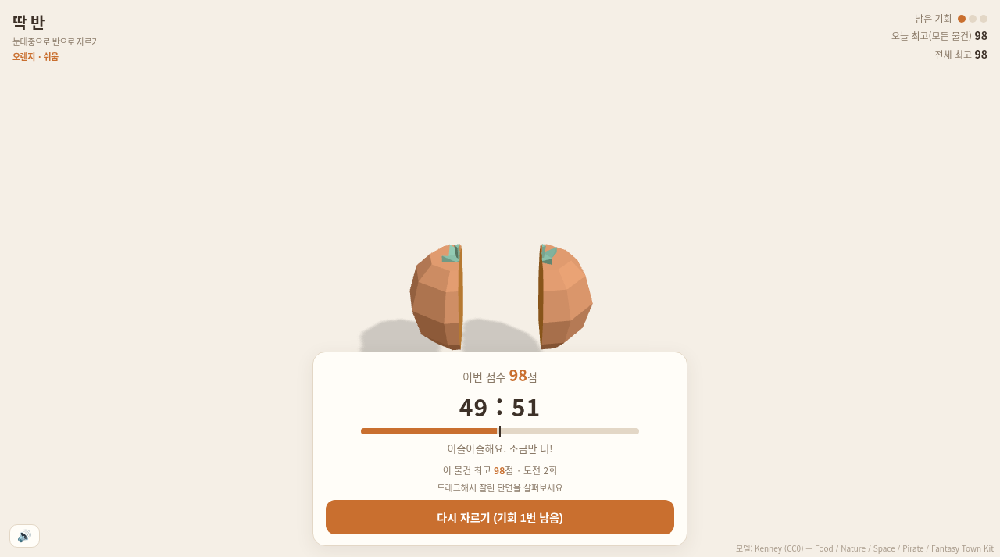
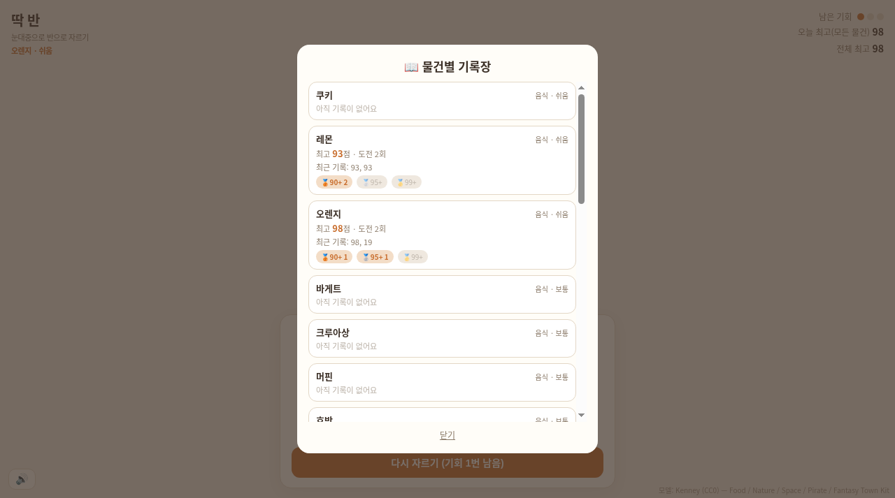
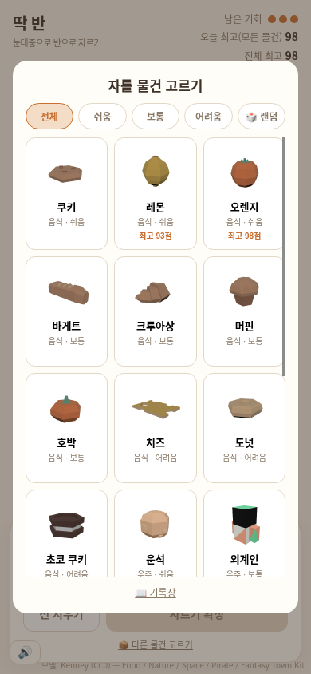
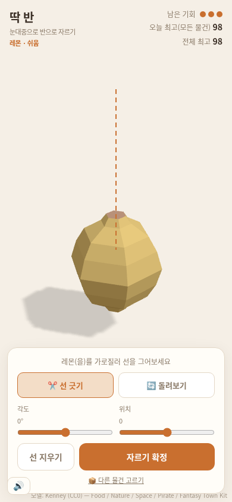

# 🪓 딱 반 (exact-half)

> 눈대중으로 3D 물건을 **정확히 반으로** 자르는 게임. 설치 없이 브라우저에서 바로 실행되는 정적 사이트(GitHub Pages)입니다.

**▶ 플레이: https://sigco3111.github.io/exact-half/**

| 물건 고르기 | 선 긋기 |
|:---:|:---:|
|  |  |
| 21종 중에서 직접 고르거나 🎲 랜덤 | 드래그로 절단선을 긋고 "자르기 확정" |

| 결과 화면 | 물건별 기록장 |
|:---:|:---:|
|  |  |
| 두 조각의 부피 비율과 점수, 조각이 함께 회전 | 물건별 최고점·시도 횟수·최근 기록·90/95/99+ 배지 |

### 📱 모바일 (390×844)

| 물건 고르기 | 플레이 |
|:---:|:---:|
|  |  |

> 스크린샷은 배포된 실제 게임을 브라우저에서 캡처한 것입니다.

## 🎮 게임 방법
1. **자를 물건 고르기**에서 원하는 오브젝트를 선택합니다. 난이도 필터(쉬움/보통/어려움)와 🎲 랜덤을 지원합니다.
2. **🔄 돌려보기** 모드에서 물건을 드래그해 돌려 보고, **✂️ 선 긋기** 모드에서 절단선을 그립니다. 각도·위치 슬라이더로 미세 조정도 가능합니다.
3. **자르기 확정**을 누르면 두 조각의 부피 비율(예: 49 : 51)과 점수(100점 만점)가 나옵니다. 시도 기회는 3번입니다.
4. 결과 화면에서 조각을 드래그해 잘린 단면을 살펴볼 수 있습니다.

## ✨ 주요 기능
- **21종 오브젝트** 와 실제 3D 미리보기 썸네일
- **물건별 기록장**: 최고점, 도전 횟수, 최근 기록(최대 10개 저장, 5개 표시), 🥉90+ / 🥈95+ / 🥇99+ 배지
- **오늘 최고 / 전체 최고** 기록 (브라우저 localStorage에 저장, 서버 없음)
- **연습 모드**: 기록에 영향을 주지 않고 자유롭게 연습
- 마우스·터치·키보드 입력 지원, 모바일 레이아웃 대응

## 🧊 오브젝트 (21종)
| 분류 | 오브젝트 |
|---|---|
| 음식 (10) | 쿠키 · 레몬 · 오렌지 · 바게트 · 크루아상 · 머핀 · 호박 · 치즈 · 도넛 · 초코 쿠키 |
| 자연 (6) | 버섯 · 바위 · 그루터기 · 돌기둥 · 나무 · 선인장 |
| 우주 (2) | 운석 · 외계인 |
| 기타 (3) | 나무통 · 대포알 · 수레 |

## 🛠 기술
- **three.js** + 자체 **평면 절단 엔진** (삼각형 클리핑, 단면 루프 체이닝, 구멍 포함 다각형 삼각분할)
- 부피는 두 조각의 **부호 체적 합**으로 정확히 계산 (정육면체·구 해석값으로 검증)
- 절단 대상 모델은 임의 평면 180회 절단 검증(부피 보존 + 닫힌 단면)을 통과한 것만 사용
- 번들: esbuild 한 파일(`app.js`) + `index.html`, 백엔드 없음

## 🔎 검증 상태
- 데스크톱: 실제 드래그·키 입력으로 플레이, 점수·기록 저장·새로고침 후 유지, 연습 모드 기록 미반영 확인
- 모바일(390×844 뷰포트): 선택·선 긋기·결과·기록장 화면 확인
- 미검증: 실제 iPhone 기기, 소리, 우클릭/두 손가락 조작은 코드 경로만 구현

## 📦 로컬 개발
```bash
npx esbuild js/main.js --bundle --format=esm --outfile=app.js --minify
```

## 📄 라이선스 / 출처
- 모델: **Kenney (CC0)** — Food Kit, Nature Kit, Space Kit, Pirate Kit, Fantasy Town Kit (`LICENSE-food-kit.txt`, 각 킷 동일 라이선스)
- 외계인 모델은 Space Kit 원본의 내부 중복 면을 정리해 닫힌 메시로 수정했습니다.
- 게임 아이디어 참고: [itland.kr 반 자르기](https://itland.kr/projects/half-cut/)
